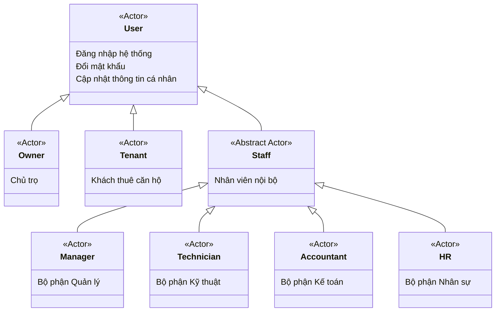
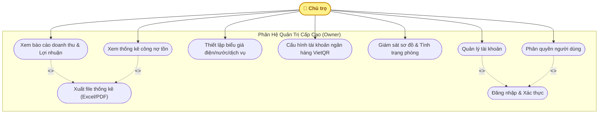
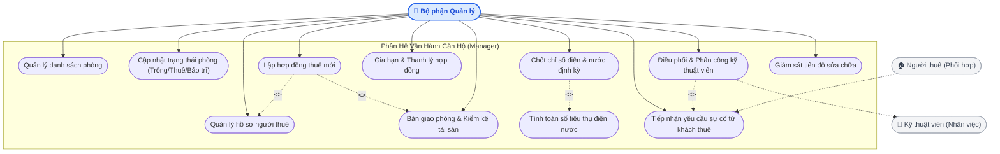
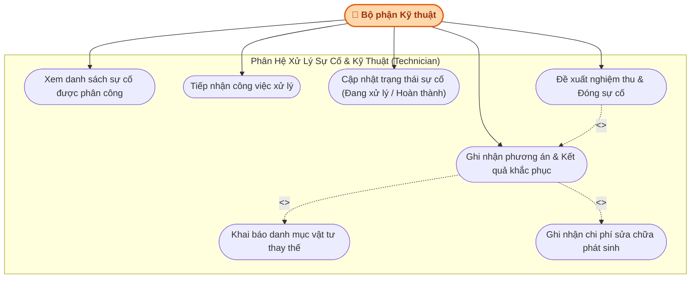
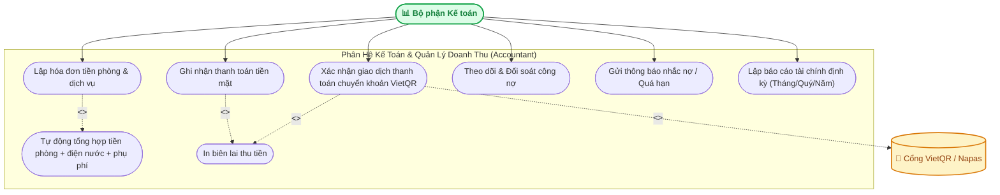
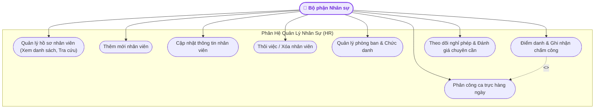
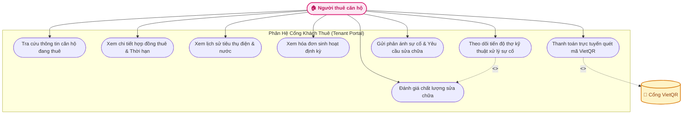
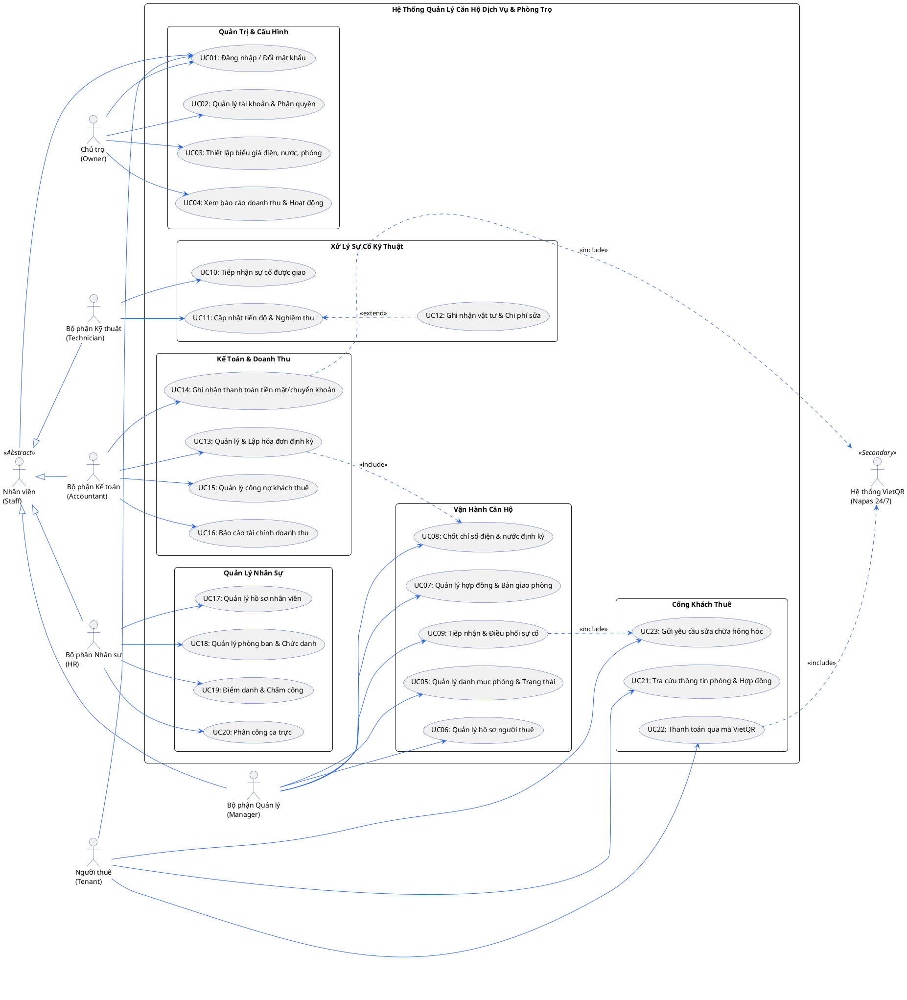

# TÀI LIỆU PHÂN TÍCH USE CASE & BIỂU ĐỒ UML
## ĐỀ TÀI: HỆ THỐNG QUẢN LÝ CĂN HỘ DỊCH VỤ & PHÒNG TRỌ (HSU)
**Môn học**: Phân tích Hướng Đối Tượng (OOAD)  
**Tài liệu tham chiếu**: `Request.txt`, `PhanTichHDT_Nhom1.docx`, Cơ sở dữ liệu và mã nguồn `apartment-web`

---

> [!TIP]
> **THƯ VIỆN HÌNH ẢNH BIỂU ĐỒ USE CASE (PNG & VECTOR SVG ĐỘ PHÂN GIẢI CAO 2K)**:
> - 🌐 **Trình xem tương tác HTML**: Mở file [`DIAGRAMS_VIEWER.html`](file:///g:/HSU/DIAGRAMS_VIEWER.html) trong trình duyệt để xem toàn bộ ảnh và tải về 1-click.
> - 🖼️ **File ảnh PNG độ nét cao (Chèn trực tiếp vào Word `PhanTichHDT_Nhom1.docx`)**:
>   - [01_use_case_tong_the.png](file:///g:/HSU/diagrams/01_use_case_tong_the.png) (2475x1770px - Toàn hệ thống)
>   - [02_use_case_chu_tro.png](file:///g:/HSU/diagrams/02_use_case_chu_tro.png) (1650x1125px - Phân hệ Chủ trọ)
>   - [03_use_case_quan_ly.png](file:///g:/HSU/diagrams/03_use_case_quan_ly.png) (1800x1275px - Phân hệ Quản lý)
>   - [04_use_case_ky_thuat.png](file:///g:/HSU/diagrams/04_use_case_ky_thuat.png) (1650x1125px - Phân hệ Kỹ thuật)
>   - [05_use_case_ke_toan.png](file:///g:/HSU/diagrams/05_use_case_ke_toan.png) (1725x1125px - Phân hệ Kế toán)
>   - [06_use_case_nhan_su.png](file:///g:/HSU/diagrams/06_use_case_nhan_su.png) (1650x1125px - Phân hệ Nhân sự)
>   - [07_use_case_khach_thue.png](file:///g:/HSU/diagrams/07_use_case_khach_thue.png) (1650x1125px - Phân hệ Cổng Khách thuê)
> - 📐 **File đồ họa Vector SVG gốc**: Thư mục [`diagrams/`](file:///g:/HSU/diagrams/)

## MỤC LỤC
1. [Xác Định & Phân Loại Tác Nhân (Actors)](#1-xác-định--phân-loại-tác-nhân-actors)
2. [Biểu Đồ UML Use Case Tổng Thể Hệ Thống (System Overview Diagram)](#2-biểu-đồ-uml-use-case-tổng-thể-hệ-thống-system-overview-diagram)
3. [Biểu Đồ UML Use Case Phân Rã Theo Từng Phân Hệ](#3-biểu-đồ-uml-use-case-phân-rã-theo-từng-phân-hệ)
   - [3.1. Phân hệ Chủ trọ (Owner)](#31-phân-hệ-chủ-trọ-owner)
   - [3.2. Phân hệ Bộ phận Quản lý (Manager)](#32-phân-hệ-bộ-phận-quản-lý-manager)
   - [3.3. Phân hệ Bộ phận Kỹ thuật (Technician)](#33-phân-hệ-bộ-phận-kỹ-thuật-technician)
   - [3.4. Phân hệ Bộ phận Kế toán (Accountant)](#34-phân-hệ-bộ-phận-kế-toán-accountant)
   - [3.5. Phân hệ Bộ phận Nhân sự (HR)](#35-phân-hệ-bộ-phận-nhân-sự-hr)
   - [3.6. Phân hệ Cổng Khách thuê (Tenant Portal)](#36-phân-hệ-cổng-khách-thuê-tenant-portal)
4. [Ma Trận Phân Quyền Tác Nhân - Use Case (CRUD / Traceability Matrix)](#4-ma-trận-phân-quyền-tác-nhân---use-case-crud--traceability-matrix)
5. [Đặc Tả Chi Tiết Các Use Case Cốt Lõi (Use Case Specifications)](#5-đặc-tả-chi-tiết-các-use-case-cốt-lõi-use-case-specifications)
6. [Mã Nguồn PlantUML (Dùng Cho Draw.io / StarUML / PlantText)](#6-mã-nguồn-plantuml-dùng-cho-drawio--staruml--planttext)

---

## 1. XÁC ĐỊNH & PHÂN LOẠI TÁC NHÂN (ACTORS)

| Tác nhân (Actor) | Vai trò trong hệ thống | Loại tác nhân | Kế thừa / Quan hệ |
| :--- | :--- | :--- | :--- |
| **Chủ trọ (Owner)** | Quản trị cấp cao nhất, toàn quyền phân quyền, thiết lập biểu giá, giám sát hoạt động và duyệt báo cáo tài chính tổng hợp. | Primary (Chính) | Độc lập |
| **Nhân viên (Staff / Employee)** | Tác nhân khái quát đại diện cho toàn thể nhân sự vận hành trong tòa nhà. | Abstract Actor | Là lớp cha của Manager, Tech, Accountant, HR |
| **Bộ phận Quản lý (Apartment Manager)** | Quản lý sơ đồ phòng, tiếp nhận khách thuê, lập hợp đồng, cập nhật chỉ số điện nước, bàn giao phòng và điều phối sự cố. | Primary (Chính) | Kế thừa từ `Nhân viên` |
| **Bộ phận Kỹ thuật (Technician)** | Tiếp nhận phiếu phân công, kiểm tra hiện trường, sửa chữa hỏng hóc, ghi nhận kết quả và chi phí linh kiện phát sinh. | Primary (Chính) | Kế thừa từ `Nhân viên` |
| **Bộ phận Kế toán (Accountant)** | Quản lý hóa đơn thu tiền định kỳ, đối soát giao dịch VietQR, thu tiền mặt, quản lý công nợ và lập báo cáo doanh thu. | Primary (Chính) | Kế thừa từ `Nhân viên` |
| **Bộ phận Nhân sự (HR)** | Quản lý danh bạ hồ sơ nhân viên, cơ cấu phòng ban chức vụ, chấm công/điểm danh và điều phối ca trực. | Primary (Chính) | Kế thừa từ `Nhân viên` |
| **Người thuê (Tenant)** | Tra cứu hợp đồng, theo dõi mức tiêu thụ điện nước, xem hóa đơn, quét VietQR thanh toán và gửi phản ánh hỏng hóc. | Primary (Chính) | Độc lập |
| **Cổng Ngân hàng VietQR (Napas 24/7)** | Hệ thống thanh toán liên ngân hàng tự động tạo QR động theo chuẩn EMVCo và xác nhận biến động số dư. | Secondary (Phụ/Ngoại vi) | External System |

### Biểu đồ Kế thừa Tác nhân (Actor Generalization Hierarchy)

---

## 2. BIỂU ĐỒ UML USE CASE TỔNG THỂ HỆ THỐNG (SYSTEM OVERVIEW DIAGRAM)

Biểu đồ này biểu diễn toàn cảnh 6 nhóm chức năng nghiệp vụ tương ứng với 6 tác nhân chính và hệ thống thanh toán ngoài:

```mermaid
flowchart LR
    %% Actors
    subgraph ACTORS["CÁC TÁC NHÂN"]
        Owner(["👑 Chủ trọ"]):::actorStyle
        Manager(["🏢 Quản lý"]):::actorStyle
        Tech(["🔧 Kỹ thuật"]):::actorStyle
        Accountant(["📊 Kế toán"]):::actorStyle
        HR(["👥 Nhân sự"]):::actorStyle
        Tenant(["🏠 Người thuê"]):::actorStyle
        Bank[("🏦 Hệ thống VietQR")]:::bankStyle
    end

    %% System Boundary
    subgraph SYSTEM["HỆ THỐNG QUẢN LÝ CĂN HỘ DỊCH VỤ & PHÒNG TRỌ"]
        
        %% Phân hệ Xác thực chung
        subgraph PKG_AUTH["Xác Thực & Quản Trị Hệ Thống"]
            UC_Login(["UC01: Đăng nhập & Xác thực"])
            UC_ChangePass(["UC02: Đổi mật khẩu"])
            UC_ManageUser(["UC03: Quản lý tài khoản & Phân quyền"])
            UC_Pricing(["UC04: Thiết lập biểu giá & Cấu hình"])
            UC_OverviewReport(["UC05: Xem báo cáo tổng hợp & Doanh thu"])
        end

        %% Phân hệ Quản lý & Vận hành
        subgraph PKG_OPS["Vận Hành Căn Hộ & Khách Thuê"]
            UC_ManageRooms(["UC06: Quản lý danh mục phòng"])
            UC_ManageTenants(["UC07: Quản lý hồ sơ người thuê"])
            UC_ManageContracts(["UC08: Quản lý hợp đồng & Bàn giao"])
            UC_RecordUtility(["UC09: Cập nhật chỉ số điện nước"])
            UC_AssignTech(["UC10: Tiếp nhận & Phân công sự cố"])
        end

        %% Phân hệ Kỹ thuật & Sửa chữa
        subgraph PKG_TECH["Bảo Trì & Xử Lý Sự Cố"]
            UC_ViewTasks(["UC11: Tiếp nhận yêu cầu phân công"])
            UC_FixIssue(["UC12: Xử lý sự cố & Nghiệm thu"])
            UC_LogCost(["UC13: Ghi nhận vật tư & Chi phí"])
        end

        %% Phân hệ Tài chính & Kế toán
        subgraph PKG_ACC["Kế Toán & Thanh Toán"]
            UC_GenInvoice(["UC14: Quản lý & Tạo hóa đơn"])
            UC_RecordPayment(["UC15: Ghi nhận thanh toán tiền mặt/chuyển khoản"])
            UC_ManageDebt(["UC16: Quản lý công nợ"])
            UC_AccReport(["UC17: Xuất báo cáo tài chính"])
        end

        %% Phân hệ Nhân sự
        subgraph PKG_HR["Quản Lý Nhân Sự & Chấm Công"]
            UC_ManageEmp(["UC18: Quản lý hồ sơ nhân viên"])
            UC_ManageDept(["UC19: Quản lý chức vụ & Phòng ban"])
            UC_Attendance(["UC20: Điểm danh & Theo dõi chấm công"])
            UC_WorkShift(["UC21: Phân công ca trực"])
        end

        %% Phân hệ Cổng Khách Thuê
        subgraph PKG_TENANT["Cổng Dịch Vụ Khách Thuê"]
            UC_ViewRoomInfo(["UC22: Tra cứu thông tin hợp đồng & phòng"])
            UC_PayInvoice(["UC23: Thanh toán hóa đơn qua VietQR"])
            UC_RequestFix(["UC24: Gửi yêu cầu sửa chữa thiết bị"])
        end

    end

    %% Quan hệ giữa Actors và Use Cases
    Owner --> UC_ManageUser
    Owner --> UC_Pricing
    Owner --> UC_OverviewReport

    Manager --> UC_ManageRooms
    Manager --> UC_ManageTenants
    Manager --> UC_ManageContracts
    Manager --> UC_RecordUtility
    Manager --> UC_AssignTech

    Tech --> UC_ViewTasks
    Tech --> UC_FixIssue
    Tech --> UC_LogCost

    Accountant --> UC_GenInvoice
    Accountant --> UC_RecordPayment
    Accountant --> UC_ManageDebt
    Accountant --> UC_AccReport

    HR --> UC_ManageEmp
    HR --> UC_ManageDept
    HR --> UC_Attendance
    HR --> UC_WorkShift

    Tenant --> UC_ViewRoomInfo
    Tenant --> UC_PayInvoice
    Tenant --> UC_RequestFix

    %% Quan hệ include / extend
    UC_GenInvoice -.->|"<<include>>"| UC_RecordUtility
    UC_FixIssue -.->|"<<extend>>"| UC_LogCost
    UC_PayInvoice -.->|"<<include>>"| Bank
    UC_AssignTech -.->|"<<include>>"| UC_RequestFix

    %% Styling
    classDef actorStyle fill:#e0f2fe,stroke:#0284c7,stroke-width:2px,color:#0369a1,font-weight:bold;
    classDef bankStyle fill:#fef3c7,stroke:#d97706,stroke-width:2px,color:#92400e;
```

---

## 3. BIỂU ĐỒ UML USE CASE PHÂN RÃ THEO TỪNG PHÂN HỆ

### 3.1. Phân hệ Chủ trọ (Owner)
Chủ trọ nắm quyền quyết định cao nhất trong hệ thống, bao gồm cấu hình các thông số thanh toán, tài khoản và theo dõi chỉ số kinh doanh.

---

### 3.2. Phân hệ Bộ phận Quản lý (Manager)
Bộ phận Quản lý chịu trách nhiệm chính về vận hành tòa nhà, tiếp nhận người thuê, hợp đồng, theo dõi phòng và chốt chỉ số tiện ích.

---

### 3.3. Phân hệ Bộ phận Kỹ thuật (Technician)
Bộ phận kỹ thuật tập trung vào quy trình tiếp nhận phân công sự cố từ Quản lý, xử lý hiện trường và ghi nhận chi phí/vật tư phát sinh.

---

### 3.4. Phân hệ Bộ phận Kế toán (Accountant)
Kế toán thực hiện việc quản trị dòng tiền, phát hành hóa đơn, kiểm soát thu chi và đối soát thanh toán chuyển khoản qua VietQR.

---

### 3.5. Phân hệ Bộ phận Nhân sự (HR)
Bộ phận nhân sự quản lý nguồn lực làm việc trong tòa nhà, quản lý thông tin nhân sự và chấm công làm việc.

---

### 3.6. Phân hệ Cổng Khách thuê (Tenant Portal)
Cổng tự phục vụ dành cho người thuê căn hộ để tăng tính minh bạch, tiện lợi và tiết kiệm thời gian vận hành.

---

## 4. MA TRẬN PHÂN QUYỀN TÁC NHÂN - USE CASE (CRUD / TRACEABILITY MATRIX)

*Ký hiệu:*
- **C** (Create): Tạo mới
- **R** (Read): Xem, tra cứu
- **U** (Update): Sửa đổi, cập nhật
- **D** (Delete): Xóa
- **X** (Execute): Thực thi tác vụ đặc thù

| Nhóm Nghiệp Vụ / Use Case | Chủ trọ (Owner) | Quản lý (Manager) | Kỹ thuật (Technician) | Kế toán (Accountant) | Nhân sự (HR) | Người thuê (Tenant) |
| :--- | :---: | :---: | :---: | :---: | :---: | :---: |
| **Quản lý Tài khoản & Phân quyền** | CRUD | R | - | - | - | - |
| **Cấu hình Đơn giá & Cài đặt hệ thống** | CRUD | R | - | R | - | - |
| **Quản lý Danh mục Phòng** | CRUD | CRUD | R | R | - | R (Xem phòng mình) |
| **Quản lý Hồ sơ Người thuê** | R | CRUD | R | R | - | U (Sửa thông tin cá nhân) |
| **Quản lý Hợp đồng thuê** | R | CRUD | - | R | - | R (Xem hợp đồng của mình) |
| **Chốt Chỉ số Điện Nước** | R | CRUD | R | R | - | R (Xem số phòng mình) |
| **Quản lý Hóa đơn & Báo giá** | R | R | - | CRUD | - | R (Xem hóa đơn mình) |
| **Thanh toán & Ghi nhận tiền** | R | - | - | CRUD | - | X (Thanh toán VietQR) |
| **Quản lý Công nợ** | R | R | - | CRUD | - | R (Xem nợ cá nhân) |
| **Gửi Yêu cầu Sửa chữa** | R | C | - | - | - | CRUD (Tạo yêu cầu cá nhân) |
| **Điều phối Sự cố cho Kỹ thuật** | R | CRUD | - | - | - | - |
| **Xử lý Sự cố & Khắc phục** | R | R | CRUD | - | - | R (Theo dõi trạng thái) |
| **Ghi nhận Vật tư & Chi phí sửa** | R | R | CRUD | R | - | - |
| **Quản lý Hồ sơ Nhân sự** | R | - | - | - | CRUD | - |
| **Phân công Ca & Chấm công** | R | R | R | - | CRUD | - |
| **Báo cáo Thống kê & Doanh thu** | CRUD | R | - | CRUD | R | - |

---

## 5. ĐẶC TẢ CHI TIẾT CÁC USE CASE CỐT LÕI (USE CASE SPECIFICATIONS)

### 5.1. Đặc tả Use Case UC-01: Chốt chỉ số điện nước & Lập hóa đơn tự động
- **Tên Use Case**: Chốt chỉ số điện nước định kỳ và tự động tạo hóa đơn tiền phòng.
- **Mã định danh**: `UC_RECORD_UTILITY_INVOICE`
- **Tác nhân chính (Primary Actor)**: Bộ phận Quản lý (Manager), Bộ phận Kế toán (Accountant).
- **Mục đích**: Ghi nhận chỉ số điện/nước hàng tháng của từng phòng, tính lượng tiêu thụ, nhân đơn giá cấu hình và tự sinh hóa đơn thanh toán cho khách.
- **Tiền điều kiện (Pre-conditions)**:
  1. Quản lý đã đăng nhập vào hệ thống với vai trò `manager` hoặc `accountant`.
  2. Phòng đang ở trạng thái `Đang thuê` và có hợp đồng còn hiệu lực.
  3. Biểu giá điện (đ/kWh), nước (đ/m3) đã được Chủ trọ cấu hình trong hệ thống.
- **Hậu điều kiện (Post-conditions)**:
  1. Bản ghi chỉ số điện nước mới được lưu vào bảng `UtilityReadings`.
  2. Hóa đơn mới được khởi tạo ở bảng `Invoices` với trạng thái `Chưa thanh toán`.
  3. Cổng khách thuê hiển thị ngay hóa đơn kèm mã VietQR tương ứng.

#### Luồng sự kiện chính (Basic Flow):
1. Quản lý chọn menu **Quản lý Điện & Nước**.
2. Hệ thống hiển thị danh sách tất cả các phòng kèm chỉ số cũ tháng trước (`PrevElectric`, `PrevWater`).
3. Quản lý chọn nút **Ghi chỉ số mới** cho phòng cần chốt (hoặc chọn chốt hàng loạt).
4. Hệ thống hiển thị biểu mẫu nhập chỉ số mới:
   - Số điện mới (kWh).
   - Số nước mới ($m^3$).
   - Tháng và Năm ghi nhận.
5. Quản lý nhập giá trị và nhấn **Lưu & Tính tiền**.
6. Hệ thống kiểm tra hợp lệ: Số mới $\ge$ Số cũ.
7. Hệ thống tự động tính:
   - Lượng tiêu thụ: $\Delta E = E_{mới} - E_{cũ}$, $\Delta W = W_{mới} - W_{cũ}$.
   - Tiền điện $= \Delta E \times$ Đơn giá điện.
   - Tiền nước $= \Delta W \times$ Đơn giá nước.
   - Tiền tổng $=$ Tiền phòng cơ bản $+$ Tiền điện $+$ Tiền nước $+$ Phí dịch vụ cố định.
8. Hệ thống tự sinh bản ghi Hóa đơn thanh toán (`Invoices`) với mã hóa đơn duy nhất (VD: `INV-202610-101`).
9. Hệ thống thông báo thành công và chuyển trạng thái hóa đơn sẵn sàng cho Kế toán đối soát.

#### Luồng sự kiện thay thế / Ngoại lệ (Alternative / Exception Flows):
- **4a. Chỉ số mới nhỏ hơn chỉ số cũ**:
  - Hệ thống báo lỗi: *"Chỉ số mới không được nhỏ hơn chỉ số kỳ trước (Cũ: X). Vui lòng kiểm tra lại đồng hồ công tơ."*
  - Yêu cầu người dùng hiệu chỉnh lại dữ liệu.
- **8a. Phòng đã được chốt chỉ số trong tháng hiện tại**:
  - Hệ thống cảnh báo: *"Phòng này đã có dữ liệu chốt tháng X/YYYY. Bạn có muốn cập nhật lại chỉ số không?"*
  - Nếu Quản lý đồng ý: Hệ thống cập nhật lại chỉ số và tính toán lại hóa đơn đã tạo.

---

### 5.2. Đặc tả Use Case UC-02: Gửi và Phân công xử lý sự cố kỹ thuật
- **Tên Use Case**: Tiếp nhận, phân công và xử lý yêu cầu sửa chữa.
- **Mã định danh**: `UC_MAINTENANCE_WORKFLOW`
- **Tác nhân tham gia**: Người thuê (Tenant), Bộ phận Quản lý (Manager), Bộ phận Kỹ thuật (Technician).
- **Mục đích**: Đảm bảo quy trình báo hỏng từ khách được điều phối nhanh chóng tới thợ kỹ thuật, có nghiệm thu và minh bạch chi phí.
- **Tiền điều kiện**: Khách thuê đã đăng nhập cổng khách thuê hoặc Quản lý ghi nhận tiếp nhận qua điện thoại.

#### Luồng sự kiện chính (Basic Flow):
1. **Khách thuê** vào cổng Tenant, chọn **Gửi yêu cầu sửa chữa**.
2. Khách điền danh mục (Điện/Nước/Điều hòa/Thiết bị), mô tả chi tiết hư hỏng, mức độ ưu tiên và gửi yêu cầu.
3. Yêu cầu hiển thị trên bảng điều khiển của **Bộ phận Quản lý** ở trạng thái `Chờ tiếp nhận`.
4. **Bộ phận Quản lý** xem chi tiết sự cố, chọn kỹ thuật viên phù hợp từ danh sách nhân sự kỹ thuật đang làm việc và nhấn **Phân công**.
5. Trạng thái sự cố đổi thành `Đã phân công`. Kỹ thuật viên được giao nhận được thông báo/thấy yêu cầu trong danh sách việc cần làm.
6. **Kỹ thuật viên** đến kiểm tra thực tế, nhấn **Bắt đầu xử lý** (trạng thái chuyển `Đang xử lý`).
7. Sau khi khắc phục xong, Kỹ thuật viên nhập:
   - Nội dung đã xử lý.
   - Vật tư/linh kiện đã thay thế.
   - Chi phí vật tư phát sinh (nếu có).
8. Kỹ thuật viên nhấn **Hoàn thành sửa chữa**.
9. Hệ thống cập nhật trạng thái sự cố thành `Hoàn thành`.
10. Khách thuê nhận thông báo hoàn tất và có thể chấm điểm đánh giá chất lượng phục vụ.

---

### 5.3. Đặc tả Use Case UC-03: Thanh toán hóa đơn qua VietQR
- **Tên Use Case**: Thanh toán tiền phòng và dịch vụ qua mã VietQR động.
- **Mã định danh**: `UC_PAY_VIETQR`
- **Tác nhân tham gia**: Người thuê (Tenant), Hệ thống Ngân hàng VietQR (Napas), Bộ phận Kế toán (Accountant).
- **Mục đích**: Cho phép khách thuê thanh toán hóa đơn tức thì 24/7 bằng bất kỳ ứng dụng ngân hàng nào qua chuẩn VietQR mà không cần nhập thủ công số tài khoản hay số tiền.

#### Luồng sự kiện chính (Basic Flow):
1. Khách thuê đăng nhập Cổng khách thuê, chọn menu **Hóa đơn & Thanh toán**.
2. Khách thuê xem hóa đơn chưa thanh toán và nhấn nút **Thanh toán VietQR**.
3. Hệ thống tạo chuỗi VietQR chuẩn EMVCo động chứa:
   - Mã định danh ngân hàng nhận (VD: MBBank - 970422).
   - Số tài khoản thụ hưởng của Chủ trọ.
   - Số tiền chính xác cần thanh toán (`TotalAmount - PaidAmount`).
   - Cú pháp nội dung chuyển khoản tự động: `THANH TOAN PHONG [SoPhong] HD [MaHoaDon]`.
4. Khách thuê mở ứng dụng Ngân hàng trên điện thoại (VCB, Techcombank, MB, Momo...), quét mã QR hiển thị trên màn hình.
5. Ứng dụng ngân hàng tự động điền đúng người nhận, số tiền và nội dung. Khách xác nhận OTP và hoàn tất chuyển khoản.
6. Hệ thống Ngân hàng xử lý giao dịch thành công.
7. Khách thuê nhấn nút **Đã chuyển khoản - Xác nhận**.
8. Kế toán kiểm tra biến động số dư tài khoản ngân hàng, nhấn **Xác nhận thanh toán** trên giao diện Kế toán.
9. Hệ thống tự động:
   - Ghi nhận một phiếu thu vào bảng `Payments`.
   - Cập nhật số tiền đã đóng (`PaidAmount`) trong hóa đơn.
   - Chuyển trạng thái hóa đơn thành `Đã thanh toán`.
   - Cập nhật công nợ phòng về mức 0 VNĐ.

---

## 6. MÃ NGUỒN PLANTUML (DÙNG CHO DRAW.IO / STARUML / PLANTTEXT)

Bạn có thể sao chép đoạn mã PlantUML dưới đây và dán trực tiếp vào [PlantText](https://www.planttext.com/) hoặc [Draw.io](https://app.diagrams.net/) (chọn *Arrange -> Insert -> Advanced -> PlantUML*) để tự động sinh file vẽ UML tiêu chuẩn:

---
*Tài liệu được khởi tạo và đồng bộ tự động với cơ sở dữ liệu `QuanLyCanHoDichVu` và mã nguồn ứng dụng web.*
